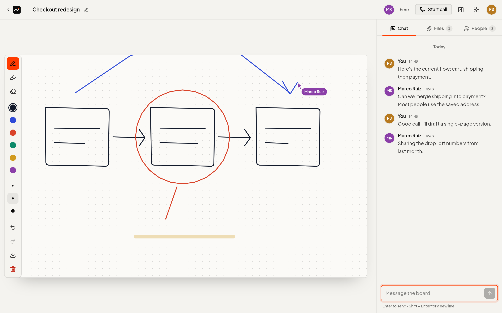
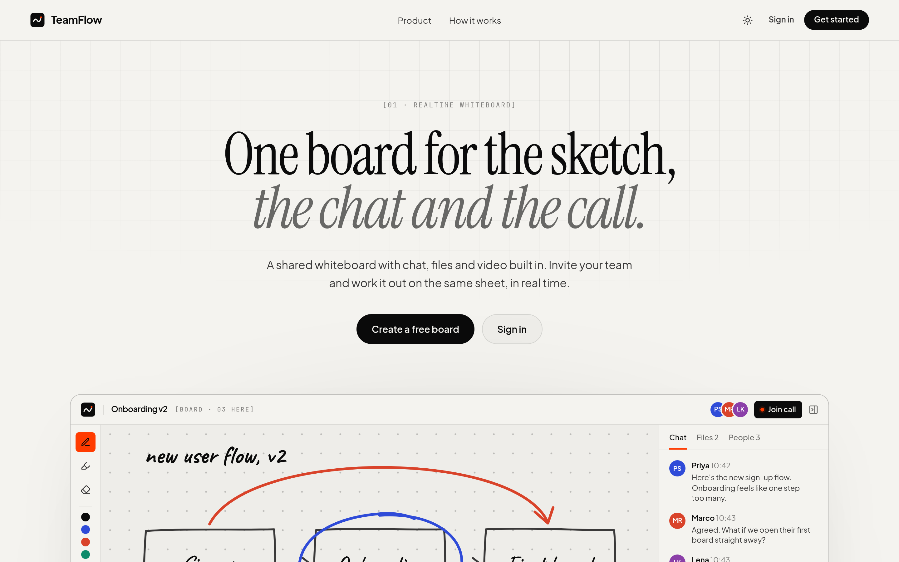
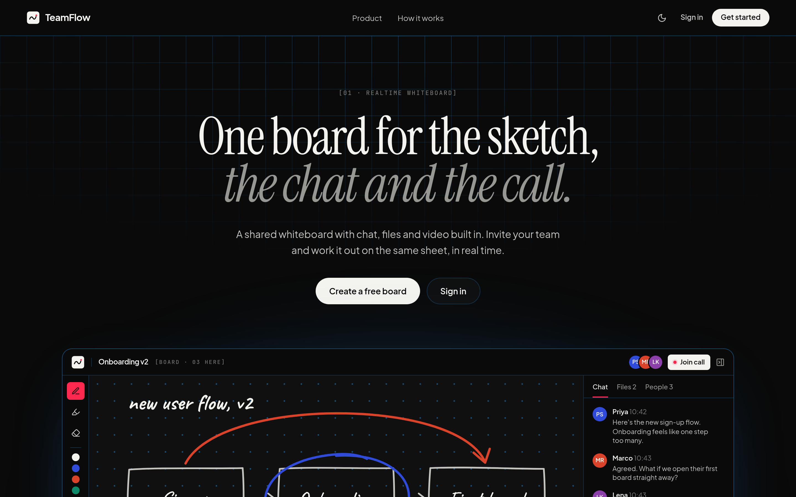
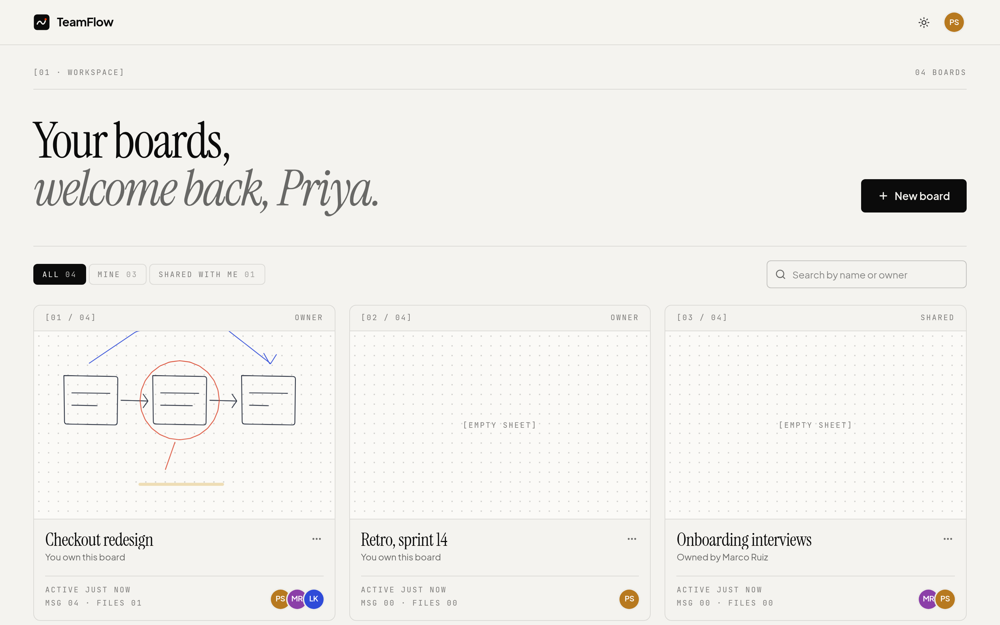
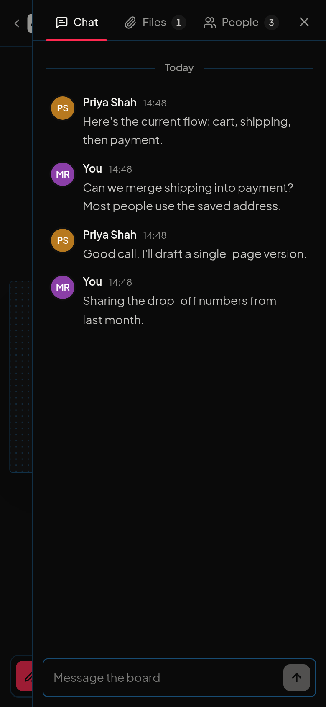
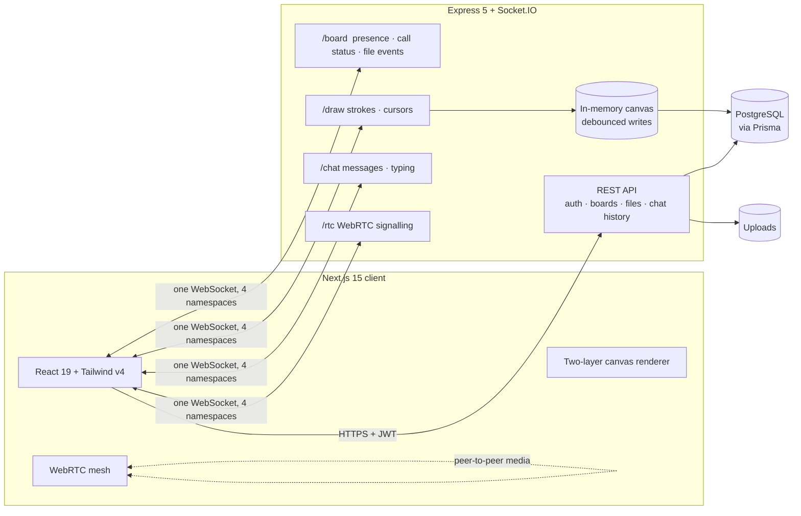

# TeamFlow

**One board for the sketch, the chat and the call.** TeamFlow is a real-time collaborative whiteboard: a shared drawing sheet with team chat, file sharing and multi-person video calls built into every board.



| Landing (light) | Landing (dark) |
| --- | --- |
|  |  |

| Dashboard | Mobile (dark) |
| --- | --- |
|  |  |

## Features

- **Shared canvas:** pen, highlighter and eraser in six marker inks and three sizes. Strokes stream to everyone *while they're being drawn*, with named live cursors. Undo/redo (Ctrl+Z / Ctrl+Shift+Z), tool shortcuts (P / H / E) and PNG export.
- **Team chat:** grouped messages, optimistic sending with retry, typing indicators, unread badges and infinite scroll back through history.
- **Files:** drag-and-drop uploads with progress and cancel, image thumbnails, and real-time sync to everyone on the board.
- **Video calls:** up to 6 people over WebRTC, with mute, camera and screen-share, speaking indicators, and a "call in progress" badge so teammates can join.
- **Boards and people:** create with invites, rename, delete, invite/remove members, leave, and live presence ("2 here").
- **Polish:** dark mode, responsive down to 360px, keyboard-accessible menus and dialogs, reduced-motion support.

## Design system

Two base colours that swap between modes, so every component inverts with no extra work:

| Token | Light | Dark |
| --- | --- | --- |
| Background | `#f4f3ef` bone | `#0a0a0a` jet |
| Text | `#0b0b0b` | `#f4f3ef` |
| Signal (active states only) | `#ff3b00` orange | `#ff2950` neon rose |
| Hairline | text at 11% | cerulean `#2a9df4` at 26% |
| 3D structure | graphite | cerulean `#1d5f8f` / `#a6dcfa` |

Secondary text is opacity steps of the text colour: 80% body, 60% supporting, 50% labels.

| Role | Typeface | Use |
| --- | --- | --- |
| Display | Instrument Serif | Headlines; the second line is italic and dimmed |
| Body | Plus Jakarta Sans | UI and reading text, 14–18px, about 44–52 characters per line |
| Metadata | JetBrains Mono | 11px uppercase labels, always with an index (`[03 · How it works]`, `02 / 06`) |

Signal colour is reserved for what's live or selected: the active tool, presence, call status, focus and unread. Visitors can switch themes from the header (the choice is remembered and applied before first paint, so there's no flash). The board follows the theme too: the sheet turns jet in dark mode, and stored ink colours are remapped per theme (black ink becomes bone, markers brighten), so a drawing made in one theme reads correctly in the other. All tokens live in `apps/frontend/app/globals.css`.

## Architecture



```
apps/
  backend/    Express 5, Socket.IO 4, Prisma 6, PostgreSQL
    src/lib/          shared Prisma client, config, access checks, HTTP errors, socket auth
    src/controllers/  REST handlers (throw HttpError; Express 5 forwards async errors)
    src/sockets/      board · draw · chat · rtc namespaces
  frontend/   Next.js 15 (App Router), React 19, Tailwind CSS v4, Zustand
    components/board/ Canvas, ChatPanel, FilesPanel, PeoplePanel, CallDock
    hooks/            useBoardSocket, useCall
    lib/canvas.ts     world coordinates + stroke renderer shared by canvas and thumbnails
```

## Design decisions worth discussing

**The canvas uses a fixed world, not pixels.** Every client draws in a 1600×1000 world and scales it to fit, so a stroke lands in the same place for everyone regardless of screen size. Points are stored as flat `[x0, y0, x1, y1, …]` arrays rounded to one decimal, which roughly halves the JSON size.

**The server owns the canvas.** The board's strokes are held in memory on the server. They're loaded once when the first person joins, appended per stroke, and written to Postgres on a 1.5s debounce. They're also written when the last person leaves and on `SIGTERM`. That replaces a DB read *and* write per stroke with roughly one write per pause in drawing. Concurrent first loads are coalesced into a single query.

**Rendering is split into two layers.** Committed strokes are drawn *incrementally* onto a base canvas: a new stroke is painted on top, with a full redraw only on undo, clear or resize. In-progress strokes (yours and other people's live previews) go on an overlay redrawn once per animation frame. Pointer input uses `getCoalescedEvents()` for smooth high-rate pen input. The eraser is a `destination-out` stroke, so it's persisted and undoable like any other, and it never erases the paper because the dot grid is a separate DOM layer.

**Authorization is checked once per socket, not once per event.** Membership is verified when a socket joins a board room and cached on the socket. Strokes, cursors and messages are checked against that cache instead of querying Postgres. The handshake verifies the JWT and loads the display name once.

**WebRTC uses fixed transceivers.** Each peer connection gets exactly one audio and one video transceiver up front. Mute, camera on/off and screen sharing are then `replaceTrack()` calls, with no renegotiation and no offer glare. The newcomer always makes the offers, and ICE candidates that arrive early are queued until the remote description is set. Turning the camera off releases it, so the hardware light goes out. Signalling only relays between sockets in the same call room.

**Chat is optimistic and idempotent.** Messages render immediately as "Sending…", confirmed by a Socket.IO acknowledgement. The broadcast and the ack can arrive in either order, so both paths dedupe by id. History is cursor-paginated (`?before=<id>`) and scroll position is preserved when older pages load.

### Security

- Every REST route and socket event checks board membership. Owner-only actions (rename, delete, invite, clear) are enforced on the server.
- Passwords are hashed with bcrypt, and responses never include them. Login errors don't reveal whether an account exists, and sign-in/sign-up are rate-limited.
- Uploads get random filenames, a size limit, and `nosniff` plus a strict CSP. Anything that isn't a known-safe type (HTML, SVG, JS…) is served as a download, so an uploaded file can't run script on the API origin.
- A file delete is authorised against the file's *own* board, not one supplied in the URL.

## Running locally

Requirements: Node 18+ and PostgreSQL (or Docker).

```bash
# 1. Database
docker run -d --name teamflow-pg -e POSTGRES_PASSWORD=dev -e POSTGRES_DB=teamflow -p 5432:5432 postgres:16-alpine

# 2. Backend (http://localhost:4000)
cd apps/backend
cp .env.example .env          # set DATABASE_URL and JWT_SECRET
npm install
npx prisma migrate deploy
npm run dev

# 3. Frontend (http://localhost:3000)
cd apps/frontend
cp .env.example .env.local    # NEXT_PUBLIC_API_URL=http://localhost:4000
npm install
npm run dev
```

Open two browser windows as two different users to see the real-time features.

### Tests

`apps/backend/test/smoke.mjs` is an end-to-end suite of 55 checks that runs against a live backend. It covers auth, board permissions, REST, all four Socket.IO namespaces, file-upload safety and WebRTC signalling. It creates unique accounts on every run, so it's safe to re-run.

```bash
cd apps/backend
API_URL=http://localhost:4000 npm run test:smoke
```

### Environment

| App | Variable | Purpose |
| --- | --- | --- |
| backend | `DATABASE_URL` | PostgreSQL connection string (required) |
| backend | `JWT_SECRET` | Token signing secret (required) |
| backend | `PORT` | Defaults to `4000` |
| backend | `CORS_ORIGIN` | Comma-separated allowed origins, or `*` |
| backend | `UPLOAD_DIR`, `MAX_UPLOAD_MB` | Upload storage path and limit (default `./uploads`, 25 MB) |
| frontend | `NEXT_PUBLIC_API_URL` | Backend origin, no trailing slash |
| frontend | `NEXT_PUBLIC_TURN_*` | Optional TURN server for calls behind strict NATs |

## Deployment notes

- Run `npx prisma migrate deploy` on every backend deploy.
- Uploads are stored on local disk. On hosts with ephemeral filesystems, mount a persistent volume at `UPLOAD_DIR` (or swap the multer storage for S3/R2).
- In-memory canvas state and presence assume a **single backend instance**. To scale horizontally, add the Socket.IO Redis adapter and move canvas state to Redis.
- Video calls work peer-to-peer with STUN on most networks. For corporate wifi and some mobile carriers, configure a TURN server (`NEXT_PUBLIC_TURN_*`).

## What I'd build next

- Infinite canvas with pan and zoom, plus shapes and text tools
- Email invites for people without an account
- Object storage for uploads, and an SFU (e.g. LiveKit) for calls with more than six people
- Run the smoke suite in CI against an ephemeral Postgres, plus Playwright tests for the two-user browser flows
